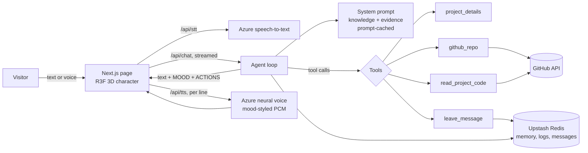

<div align="center">

# agentic-ai-portfolio

**Elio: a 3D AI agent that lives on your portfolio, talks to recruiters, and sells your work, with tools, memory, voice and evals.**

[**Live demo → ghanshyampaunikar.com**](https://ghanshyampaunikar.com) · [Watch the 2-minute video](docs/elio-demo.mp4) · [How Elio works](https://ghanshyampaunikar.com/lab)


</div>

---

A portfolio is a page people skim for ten seconds. This one talks back.

**Elio** is a TV-headed 3D character who greets visitors, answers anything about Ghanshyam's work, pastes a job description into a fit check, puts the right project on his own screen while he talks about it, and passes a message on when someone wants to hire. He is an LLM agent with tools, not a canned chatbot: he decides when to look up a project's internals, check GitHub live, or read the actual source code before answering.

## What Elio does

| | |
|---|---|
| 🧠 **Agentic tool use** | Claude decides mid-answer whether to call `project_details` (deep notes written from the code), `github_repo` (live repo facts), `read_project_code` (reads real files) or `leave_message` (contacts the owner). Results are cached and short to keep each extra step cheap. |
| 🎯 **Job-fit check** | Paste a job description and get a verdict mapped to real evidence: which requirement is met by which job or project, where the gaps are, and what to ask next. |
| 📺 **Acts, not just talks** | Replies carry action tags (`[show:innerbloom]`, `contact`, `resume`) that the page turns into UI: the project card appears on Elio's screen as he introduces it. |
| 🗣️ **Voice in and out** | Natural speech via Azure AI Speech, streamed as raw PCM so Elio starts talking before the sentence is finished. Each line carries a mood that changes the voice style *and* the face. Tap the mic to talk; it stops when you pause. |
| 💾 **Memory** | The model can emit a `REMEMBER:` line ("recruiter at Acme, hiring a senior ML engineer"). It is stored per visitor, so a second visit starts with "welcome back" and picks up where they left off. |
| 🛡️ **Grounded and safe** | Every fact comes from a versioned knowledge file. The prompt forbids inventing anything, says what is deliberately not on record (salary, notice period), and resists prompt injection. |
| ✅ **Evaluated** | `scripts/eval-pix.mjs` runs 32 cases through the real API: grounding, admitting unknowns, no invention, injection, job fit, multi-turn. Plain-rule checks, not LLM-as-judge. Results are published on [/lab](https://ghanshyampaunikar.com/lab). |
| 🎮 **Personality** | Poke him and he reacts. Play Snake, Dino or Tetris on his face. Point at a link and its preview shows on his screen. |
| 📊 **Owner dashboard** | `/admin` shows visits, the questions people asked, who they were and messages left, behind a key. The owner's own visits are not logged. |

## How it works



1. **The prompt is the knowledge base.** `src/data/` holds the facts (experience, projects, skills with evidence), compiled into one ~30K-token system prompt that is **prompt-cached**, so every question after the first reuses it cheaply.
2. **The agent loop** streams Claude's answer over SSE. When Claude calls a tool, the route runs it, feeds the result back and keeps streaming. Elio starts speaking the first sentence while the rest is still being written.
3. **The reply format** is plain text plus a few control lines (`MOOD:`, `ACTIONS:`, `REMEMBER:`) the client strips out and acts on: face expression, voice style, buttons, on-screen cards, memory.
4. **The 3D character** is a rigged glTF (meshopt-compressed) rendered with React Three Fiber. The TV screen is a live canvas texture: eyes, expressions, project cards or a game.
5. **Fallbacks everywhere.** A failed model call is retried once; if it still fails, Elio answers from the portfolio's own search instead of going silent. Without WebGL the page still works, just without the 3D character.

## Tech stack

**Frontend** Next.js 16 (App Router), React 19, TypeScript, Tailwind CSS 4, React Three Fiber + drei, Three.js
**AI** Claude (Anthropic SDK) with tool use and prompt caching, or Gemini / Groq on free tiers · Azure AI Speech (neural TTS with styles, STT)
**Backend** Next.js route handlers on Vercel, SSE streaming, Upstash Redis (KV), per-IP and global rate limits
**Quality** Rule-based eval suite, TypeScript strict, ESLint

## Run it locally

```bash
git clone https://github.com/GhanshyamPaunikar/agentic-ai-portfolio.git
cd agentic-ai-portfolio
npm install
cp .env.example .env.local   # add at least one LLM key
npm run dev
```

Open http://localhost:3000. Only an LLM key is required; everything else is optional and degrades gracefully.

| Variable | Needed for |
|---|---|
| `ANTHROPIC_API_KEY` *or* `GEMINI_API_KEY` *or* `GROQ_API_KEY` | Elio's answers (Claude recommended for tool use) |
| `LLM_PROVIDER`, `LLM_MODEL`, `LLM_CACHE_TTL` | Pick a provider or model, keep the prompt cache warm |
| `AZURE_SPEECH_KEY`, `AZURE_SPEECH_REGION` | Elio's voice and the mic (free F0 tier is plenty) |
| `KV_REST_API_URL`, `KV_REST_API_TOKEN` | Memory, messages and the `/admin` dashboard (Upstash) |
| `ADMIN_KEY` | Unlocking `/admin` |
| `GITHUB_TOKEN` | Higher GitHub rate limit for the live repo tools |

Run the evals against your local server:

```bash
node scripts/eval-pix.mjs http://localhost:3000
```

## Make it your own

Elio is built around one person's record, but everything personal lives in data files:

| File | What to change |
|---|---|
| `src/data/portfolio.ts` | Name, projects, certificates, skills, links |
| `src/data/assistant-knowledge.ts` | The facts Elio is allowed to state |
| `src/data/assistant-evidence.ts` | Skill → proof mapping used for job-fit checks |
| `src/data/project-details.ts` | Deep notes per project (written from the code) |
| `src/lib/assistant-prompt.ts` | Elio's personality, rules and reply format |
| `scripts/sync-github.mjs` | Snapshot your public repos into Elio's knowledge |
| `scripts/eval-pix.mjs` | Your own test questions |

Swap the 3D model in `src/components/v4/ghanshyam.tsx` if you want a different character.

## Project structure

```
src/
  app/
    page.tsx            the homepage (Elio)
    api/chat            agent loop: streaming, tools, memory, rate limits
    api/tts, api/stt    Azure speech, streamed
    api/message         contact form → owner's dashboard
    admin, lab          owner dashboard, public eval results
  components/v3, v4     the site, the 3D character, face, games, voice, mic
  data/                 everything Elio knows
  lib/                  LLM providers, tools, prompt, KV, rate limiting
scripts/                evals, GitHub sync, repo scanner
```

## Credits

- 3D TV head based on ["tv head"](https://sketchfab.com/3d-models/tv-head-0ae68369ffb445f284625884b96b47eb) by [sBjamms](https://sketchfab.com/sbjamms11), licensed under [CC BY 4.0](http://creativecommons.org/licenses/by/4.0/).

## License

Code is MIT licensed, see [LICENSE](LICENSE). The personal content (résumé, photos, project write-ups, the knowledge files about Ghanshyam) is his and not licensed for reuse: replace it with your own.

---

<div align="center">

Built by **[Ghanshyam Paunikar](https://ghanshyampaunikar.com)**, AI Engineer · [LinkedIn](https://www.linkedin.com/in/ghanshyampaunikar/) · [GitHub](https://github.com/GhanshyamPaunikar)

If Elio made you smile, a ⭐ helps others find him.

</div>
